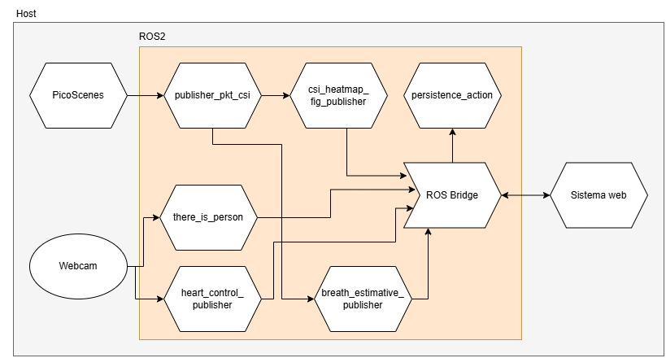

# AIMS System

Advanced MultIModal Sensing (AIMS) é um sistema de monitoramento de sinais vitais baseado em ROS 2, PicoScenes e interface web.

## Repositório oficial

Origem do projeto:

```bash
https://github.com/LABORA-INF-UFG/AIMS-System
```

Clone com:

```bash
git clone https://github.com/LABORA-INF-UFG/AIMS-System.git
cd AIMS-System
```

## Arquitetura atual

A arquitetura em uso é exibida abaixo:



## Dependências principais

- [PicoScenes](https://ps.zpj.io/)
- [ROS 2 Foxy](https://docs.ros.org/en/foxy/index.html)
- Node.js 19 (instalado pelo script de setup)

## Instalação automatizada

Os scripts de instalação estão em [scripts](scripts). Execute todos a partir dessa pasta, na ordem abaixo:

```bash
cd scripts
source 1_install_picoscenes.bash
source 2_install_PicoScenesToolbox.bash
source 3_install_ros2_foxy.bash
```

### O que o terceiro script configura

O script [scripts/3_install_ros2_foxy.bash](scripts/3_install_ros2_foxy.bash):

- instala ROS 2 Foxy, dependências do workspace e Node.js 19
- faz build do workspace [aims_ws](aims_ws)
- instala dependências web
- exporta variáveis de ambiente no ~/.bashrc:

```bash
AIMS
AIMSWS_LOCALSETUP
KERAS_APNEA_MODEL
RMW_IMPLEMENTATION
FASTRTPS_DEFAULT_PROFILES_FILE
ROS_DOMAIN_ID
```

## Build manual (quando necessário)

Se precisar rebuildar manualmente:

```bash
cd <raiz-do-repositorio>
source /opt/ros/foxy/setup.bash
source build.bash
```

## Inicialização do ambiente

### 1) Em terminal novo

```bash
source $AIMSWS_LOCALSETUP
```

### 2) Em cenário com duas máquinas (TX e RX)

Na máquina TX (transmissora), execute:

```bash
./picoscenes_routine_tx.bash
```

### 3) Inicie o sistema completo (RX)

```bash
ros2 launch csi aims_launch.py
```

Esse launch sobe os nós ROS2, o backend web e tenta abrir o navegador em http://localhost:3001.

### 4) Opção de launch reduzido/core

Para cenários de teste com launch mais enxuto:

```bash
ros2 launch csi aims_core_launch.py
```

## Observações importantes de execução

- Uma webcam conectada pode ser necessária para nós que usam visão (ex.: detecção de pessoa).
- Se o modelo de apneia não estiver presente localmente, ajuste o caminho em `KERAS_APNEA_MODEL`.
- Se o browser não abrir automaticamente, acesse manualmente http://localhost:3001.

## Módulos e tópicos principais

| Nó | Função | Tópicos |
|---|---|---|
| publisher_pkt_csi | Recebe frame em bytes do PicoScenes, faz parse e publica no ROS. | /pktcsi |
| publisher_mmw | Comunica com placa mmWave e publica sinais. | /brmmw, /hrmmw |
| persistence_action | Action para persistir capturas de CSI e sinais auxiliares. | /persist_csi |
| mocked_pkt_csi_publisher | Simula envio de pacotes CSI a partir de arquivo em resource. | /pktcsi |
| csi_heatmap_fig_publisher | Publica heatmap para feedback de sinal. | /heatmap |
| breath_estimative_publisher | Estimativa de respiração e detecção simplificada de apneia. | /estimativebreath |
| breath_estimative_cardiofi_publisher | Estimativa de respiração e batimento via CardioFi. | /estimativebreath_cardiofi, /estimativeheart_cardiofi |
| apnea_ai_publisher | Predição de apneia com IA. | /apnea_ai |
| octave_cardiofi_publisher | Estimativa de respiração e batimento via Octave/Matlab. | /octave_cardiofi |
